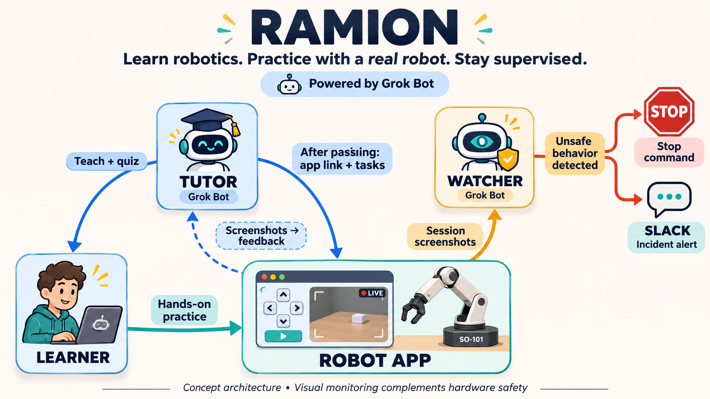

# Guide the learner. Protect the robot.

**Grok Bot workflows for learning on real robots — and monitoring how they're used.**

Remote robotics has two challenges: beginners need a coach, and operators need to protect real hardware. Our hackathon project tackles both.

| For the learner: TUTOR | For the operator: WATCHER |
| --- | --- |
| Teaches the basics and checks understanding. | Observes camera views and robot readings. |
| Guides real exercises: open the gripper, close it, rotate the base 90°. | Flags risky behavior and repeated misuse. |
| Compares before/after screenshots and gives feedback when you say “done.” | Sends Slack alerts so a human can intervene. |

Concept overview. TUTOR runs in Grok Bot; WATCHER uses a separate monitoring service. Optional software stop is off by default.

**The experience:** learn → pass the quiz → operate a real arm → get feedback, while the session is monitored.

## What we built for the hackathon

**The submission is the Grok Bot tutoring and monitoring workflows, with supporting observation and alerting code.**

[RAMION](https://ramion.cloud/) is a startup providing **Robots as a Service**. The physical robots and RAMION app already exist and **are not part of this hackathon submission**. They provide the real-world environment for our bots.

---

[Monitoring demo →](packages/watcher/demo/DEMO.md) · [TUTOR & template setup](tutor/) · [WATCHER](packages/watcher/)

Wrocław Grok Bot Hackathon · November 5, 2026 · [ramion.cloud](https://ramion.cloud/)
