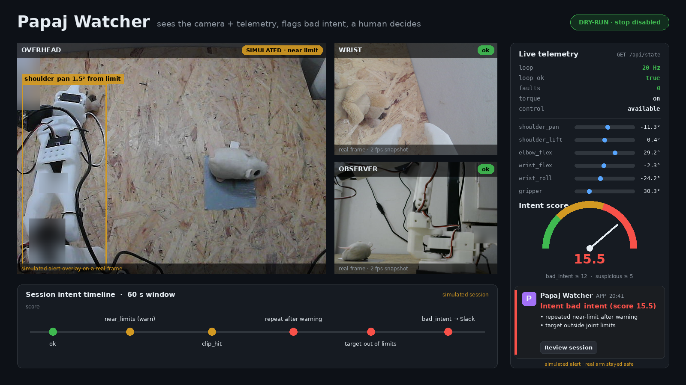
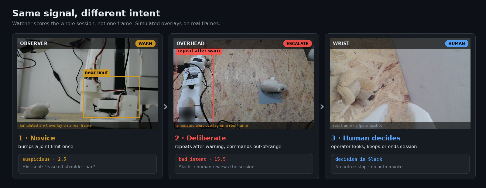
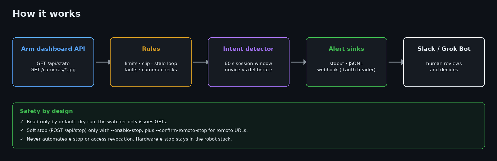
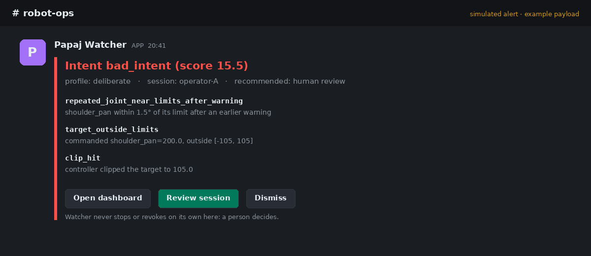
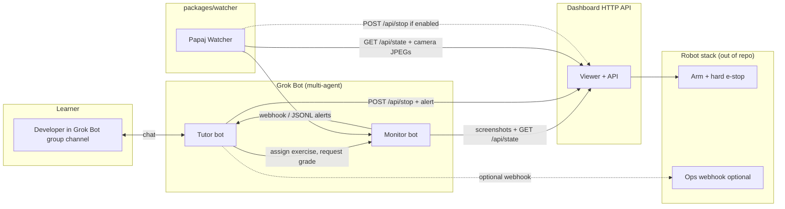

# Papaj Watcher: a safety watcher for remote robot arms

**Papaj Watcher reads a real arm's cameras and telemetry, spots risky or malicious remote sessions, and alerts a human in Slack.**


<sub>Real camera frames from our SO-101 arm. The risky state is a simulated alert overlay; the real arm was never put in danger.</sub>

## Why

- **Remote users can break real hardware.** Ramion rents time on a physical arm, so a careless or hostile session costs real money.
- **Watcher sees camera + telemetry.** It polls `GET /api/state` and the camera snapshots, then scores the whole session (60 s window), not single frames.
- **It flags bad intent to Slack, and a human decides.** It does not trigger the e-stop or revoke access on its own.

## Use case in 3 steps



1. **Novice** bumps a joint limit once → `suspicious`, a gentle warning.
2. **Deliberate misuse** (repeats after the warning, commands targets outside the limits) → `bad_intent`, escalated.
3. **Human review** in Slack: the operator decides whether to keep or end the session.



## Safety by design

- **Dry-run by default:** the watcher only reads (GET) until you opt in.
- **Soft stop is gated:** `POST /api/stop` only with `--enable-stop` (plus `--confirm-remote-stop` for non-loopback URLs).
- **No e-stop or revoke automation:** the hardware e-stop stays in the robot stack; access decisions stay with people.
- **Secrets stay private:** webhook auth (`PAPAJ_WEBHOOK_AUTH`) is sent as a header and never logged.



## 30-second quickstart

```bash
cd packages/watcher
python3 -m unittest discover -s tests        # 45 tests, all passing
export RAMION_DASHBOARD_URL=http://127.0.0.1:8780
python3 -m papaj_watcher --webhook "$PAPAJ_WEBHOOK_URL"   # dry-run, intent detector on
```

**Live demo:** a soft forbidden zone `shoulder_pan < -60°` triggers the full path to Slack; see [`packages/watcher/demo/DEMO.md`](packages/watcher/demo/DEMO.md).

Works alongside the existing arm dashboard HTTP API (`/api/state`, `/cameras/*.jpg`) as an external client. No changes to the robot server.

---

<details><summary>Hackathon context: Ramion × Grok Bot multi-agent tutor</summary>

**Hackathon:** Wrocław Grok Bot Hackathon · **Date:** 5 Nov 2026 · **Track:** Multi-agent systems on Grok Bot
**Repo history:** This repository started **empty** (`ramion-cloud/grokbot`). It now holds the Tutor + Monitor agent recipes and the Papaj Watcher package. It is not a clone of the robot server.

</details>

## Pitch (30 seconds)

Developers want to learn robotics without buying hardware. **Ramion** rents time on a real robotic arm and lets you operate it remotely. This submission wires **three** roles — **Tutor**, **Monitor**, and **Papaj Watcher** — so a learner gets a guided intro, passes a safety quiz, receives the viewer link, completes hands-on exercises, and gets automatic pass/fail grading from screenshots and API state. Watcher polls camera snapshots and joint telemetry, emits team warnings, and can request a software STOP. The **hard e-stop** lives in the robot stack, not in chat bots.

## Problem

- Robotics learning curves are steep: kinematics, safety, and tooling before touching hardware.
- Remote labs need **gating** (who gets control), **observability** (did the learner succeed?), and **clear safety boundaries** between teaching bots and the physical stack.

## Solution

| Agent | Role |
|-------|------|
| **Tutor** | Teaches a short curriculum, runs a quiz gate, shares the viewer URL from `RAMION_VIEWER_URL`, assigns exercises, reacts to Monitor pass/fail. |
| **Monitor** | Observes the live session (viewer screenshots on a cadence and/or `GET /api/state`), grades against rubrics, returns structured pass/fail to Tutor. Consumes Watcher alerts from a webhook or JSONL log — it does not re-run Watcher rules. |
| **Watcher** ([`packages/watcher`](packages/watcher)) | Polls snapshots + telemetry, emits `info` / `warning` / `critical` findings, and optionally posts `POST /api/stop` (dry-run by default). |

Configure dashboard URLs in a private env file (`RAMION_BASE_URL`, `RAMION_DASHBOARD_URL`, `RAMION_VIEWER_URL`). Do not put private hostnames, addresses, tokens, personal information, or live camera frames in this repository.

## Architecture



**Safety model:** Tutor or Watcher may call the software **soft-stop** (`POST /api/stop`). Watcher keeps that path **disabled** unless `--enable-stop` is set (and `--confirm-remote-stop` for non-loopback URLs). **Emergency stop** is hardware/firmware on the robot side; bots never claim to replace it.

## How Grok Bot is used (beyond “coding assistant”)

1. **Persistent personas** (`bots/tutor/PERSONA.md`, `bots/monitor/PERSONA.md`) and **skills** (`bots/*/skills/`) encode curriculum, quiz rules, exercise scripts, and grading rubrics — reproducible operator playbooks.
2. **Group channel** pairs learner + Tutor; Tutor **delegates observation** to Monitor (second bot) instead of hallucinating success.
3. **Monitor** grades from `GET /api/state` and viewer screenshots. When Papaj Watcher is running, Monitor also reads its webhook or JSONL alerts (`source`, `level`, `rule`, `message`) and treats Watcher `critical` findings as safety context — it does not reimplement those heuristics.
4. **Template sharing:** Tutor bot is published as a **Template** so other teams can fork the hackathon flow (see `SETUP.md`).

## Repository layout

```
README.md                 ← you are here
SETUP.md                  ← create bots, channel, watcher wiring
docs/architecture.md      ← boundaries, data flow, vision strategy
api/contract.md           ← HTTP contract for the dashboard (verified + proposed)
bots/tutor/               ← persona + skills (curriculum, quiz, exercises)
bots/monitor/             ← persona + skills (observe, grade, consume Watcher alerts)
packages/watcher          ← Papaj Watcher (HTTP client, rules, tests)
packages/onboarding       ← reserved
packages/training         ← reserved
demo/CHECKLIST.md         ← 3-minute judge path
.gitignore
```

Packages talk to the dashboard as external HTTP clients; they do not vendor dashboard or controller source.

## Watcher quick start

```bash
cd packages/watcher
python3 -m unittest discover -s tests -v
export RAMION_DASHBOARD_URL=http://127.0.0.1:8780
python3 -m papaj_watcher --once
```

See [`packages/watcher/README.md`](packages/watcher/README.md) for routes, safety flags, webhooks, the optional VLM layer, and a systemd example.

## 3-minute demo script

| Time | Who | Action |
|------|-----|--------|
| 0:00 | Presenter | Agent recipe for Ramion’s remote arm lab. Show README architecture diagram. |
| 0:30 | Tutor | New learner in group channel: `/start` or “I’m new” → 2-minute intro + 3-question safety quiz. |
| 1:30 | Tutor | On pass: paste `RAMION_VIEWER_URL`; assign **Exercise 1: Open gripper**. |
| 2:00 | Learner | Operates gripper in viewer; Monitor runs screenshot cadence + `GET /api/state`. |
| 2:30 | Monitor | Posts `PASS` or `FAIL` with one-line reason to Tutor thread. |
| 2:45 | Tutor | On pass: next exercise or completion badge; mention Watcher (`packages/watcher`) + hard e-stop boundary. |

Full step list: [`demo/CHECKLIST.md`](demo/CHECKLIST.md).

## Links

| Resource | URL |
|----------|-----|
| This repo | https://github.com/ramion-cloud/grokbot |
| API contract | [`api/contract.md`](api/contract.md) |
| Operator setup | [`SETUP.md`](SETUP.md) |
| Papaj Watcher | [`packages/watcher/README.md`](packages/watcher/README.md) |

## Team notes

- **In scope:** Tutor + Monitor personas/skills, Papaj Watcher, architecture docs, API contract, demo checklist.
- **Out of scope:** robot firmware, the dashboard/controller server source.
- Configure `RAMION_BASE_URL` / `RAMION_DASHBOARD_URL` / `RAMION_VIEWER_URL` privately. Do not commit live frames or secrets.

---

Built for the Wrocław Grok Bot hackathon · Ramion startup · Nov 5, 2026.
