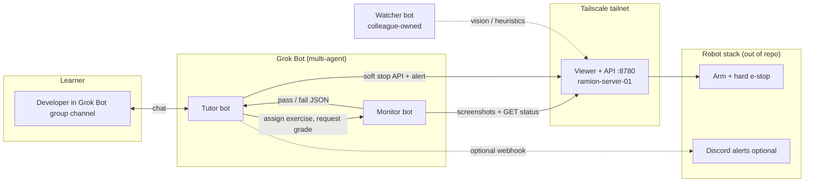

# Ramion × Grok Bot — Multi-Agent Robotics Tutor

**Hackathon:** Wrocław Grok Bot Hackathon · **Date:** 5 Nov 2026  
**Track:** Multi-agent systems on Grok Bot  
**Repo history:** This repository started **empty** (`ramion-cloud/grokbot`); this commit scaffolds the agent-native submission (docs + bot recipes — not a clone of the robot server).

## Pitch (30 seconds)

Developers want to learn robotics without buying hardware. **Ramion** rents time on a real robotic arm and lets you operate it remotely. This submission wires **two Grok Bot agents** — **Tutor** and **Monitor** — so a learner gets a guided intro, passes a safety quiz, receives the live viewer link, completes hands-on exercises, and gets automatic pass/fail grading from screenshots and API state. A separate **Watcher** agent (colleague-owned, out of scope here) handles abuse detection; the **hard e-stop** lives in the robot stack, not in chat bots.

## Problem

- Robotics learning curves are steep: kinematics, safety, and tooling before touching hardware.
- Remote labs need **gating** (who gets control), **observability** (did the learner succeed?), and **clear safety boundaries** between teaching bots and the physical stack.

## Solution

| Agent | Role |
|-------|------|
| **Tutor** | Teaches a short curriculum, runs a quiz gate, shares the Tailscale viewer URL, assigns exercises, reacts to Monitor pass/fail. |
| **Monitor** | Observes the live session (viewer screenshots on a cadence and/or HTTP status), grades against rubrics, returns structured pass/fail to Tutor. |
| **Watcher** *(documented only)* | Detects bad actors / dangerous motion patterns; alerts ops. Not implemented in this repo. |

Live app (private Tailscale — learners need tailnet access):

- `http://ramion-server-01:8780/`
- MagicDNS: `http://ramion-server-01.tail0fbdb0.ts.net:8780/`

## Architecture



**Safety model:** Bots may call **soft-stop** HTTP endpoints and post to Discord. **Emergency stop** is hardware/firmware on the robot side; bots never claim to replace it.

## How Grok Bot is used (beyond “coding assistant”)

1. **Persistent personas** (`bots/tutor/PERSONA.md`, `bots/monitor/PERSONA.md`) and **skills** (`bots/*/skills/`) encode curriculum, quiz rules, exercise scripts, and grading rubrics — reproducible operator playbooks.
2. **Group channel** pairs learner + Tutor; Tutor **delegates observation** to Monitor (second bot) instead of hallucinating success.
3. **Monitor** uses Grok Bot tools (browser/screenshot cadence or HTTP) against the **MagicDNS** URL so grading works off-tailnet hostnames consistently.
4. **Template sharing:** Tutor bot is published as a **Template** so other teams can fork the hackathon flow (see `SETUP.md`).

## Repository layout

```
README.md                 ← you are here
SETUP.md                  ← create bots, Tailscale, channel, template
docs/architecture.md      ← boundaries, data flow, vision strategy
api/contract.md           ← proposed HTTP contract for :8780 (align with real server)
bots/tutor/               ← persona + skills (curriculum, quiz, exercises)
bots/monitor/             ← persona + skills (observe, grade)
demo/CHECKLIST.md         ← 3-minute judge path
.gitignore
```

## 3-minute demo script

| Time | Who | Action |
|------|-----|--------|
| 0:00 | Presenter | “Empty repo → agent recipe for Ramion’s remote arm lab.” Show README architecture diagram. |
| 0:30 | Tutor | New learner in group channel: `/start` or “I’m new” → 2-minute intro + 3-question safety quiz. |
| 1:30 | Tutor | On pass: paste MagicDNS viewer link; assign **Exercise 1: Open gripper**. |
| 2:00 | Learner | Operates gripper in viewer; Monitor runs screenshot cadence + optional `GET /api/v1/state`. |
| 2:30 | Monitor | Posts `PASS` or `FAIL` with one-line reason to Tutor thread. |
| 2:45 | Tutor | On pass: next exercise or completion badge; mention Watcher + hard e-stop boundary. |

Full step list: [`demo/CHECKLIST.md`](demo/CHECKLIST.md).

## Links

| Resource | URL |
|----------|-----|
| This repo | https://github.com/ramion-cloud/grokbot |
| Live viewer (tailnet) | http://ramion-server-01.tail0fbdb0.ts.net:8780/ |
| API contract (proposed) | [`api/contract.md`](api/contract.md) |
| Operator setup | [`SETUP.md`](SETUP.md) |

## Team notes

- **In scope:** Tutor + Monitor personas/skills, architecture docs, proposed API contract, demo checklist.
- **Out of scope:** Watcher implementation, robot firmware, full :8780 server source.
- **TODO for integration:** Map proposed endpoints in `api/contract.md` to the real Ramion server; set Monitor `RAMION_BASE_URL` to MagicDNS in production.

---

Built for the Wrocław Grok Bot hackathon · Ramion startup · Nov 5, 2026.
