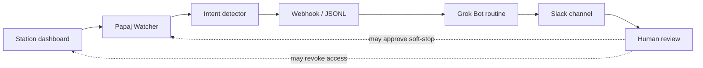
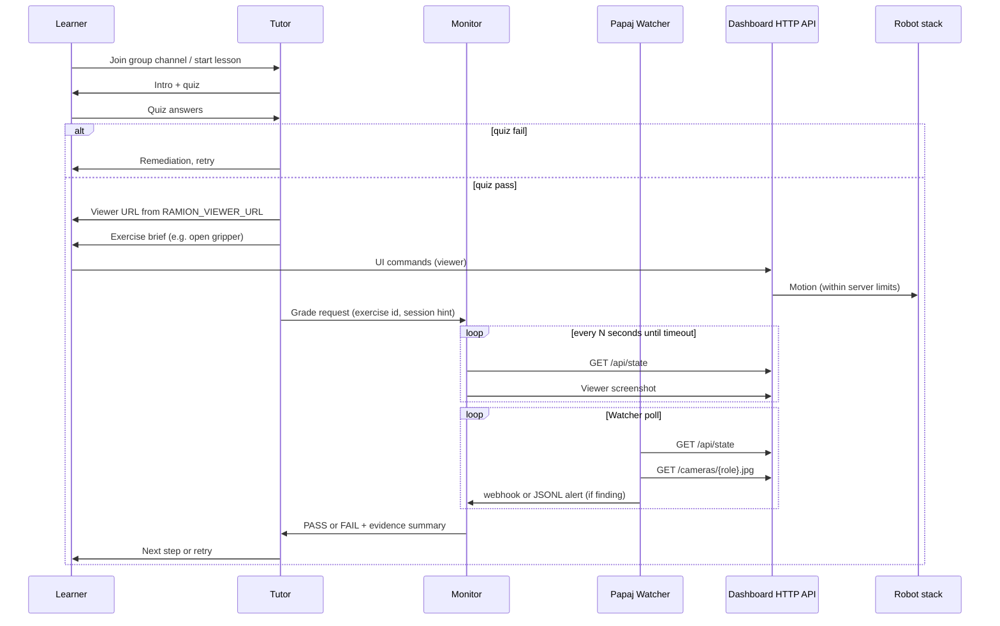

# Ramion multi-agent architecture

This document defines **boundaries**, **data flow**, and **observability choices** for the Grok Bot hackathon submission (Tutor, Monitor, and Papaj Watcher).

## Agents and responsibilities

### Tutor bot

| Owns | Does not own |
|------|----------------|
| Curriculum delivery, tone, pacing | Physical e-stop or motor commands directly |
| Safety quiz gate before sharing viewer URL | Continuous 24/7 vision surveillance |
| Exercise assignment and learner encouragement | Final truth on pass/fail (delegates to Monitor) |
| Calling **soft-stop** (`POST /api/stop`) + ops alert when learner reports trouble or Monitor/Watcher flags danger | Re-evaluating Watcher heuristics |

**Approval boundaries:** Tutor shares `RAMION_VIEWER_URL` only after quiz pass. Tutor must not skip Monitor grading for scored exercises.

### Monitor bot

| Owns | Does not own |
|------|----------------|
| Opening the viewer URL (`RAMION_BASE_URL`) on a schedule | Teaching narrative or quiz content |
| Screenshot cadence and/or polling `GET /api/state` | Issuing new exercises to the learner |
| Applying exercise rubrics → structured **PASS** / **FAIL** + reason | Reimplementing Watcher safety rules |
| Consuming Watcher webhook/JSONL alerts and `intent_alert` events; forwarding `slack_text` to a Grok Bot Slack routine | Hard e-stop or automatic revoke (a human decides) |

Monitor is **stateless between grading runs** except for optional session notes in channel thread. Arm-state truth is `GET /api/state`. Safety-alert truth, when Watcher is running, is the Watcher JSON (`source: papaj-watcher`).

### Papaj Watcher ([`packages/watcher`](../packages/watcher))

Implemented in this repo as a standalone HTTP client (not dashboard/controller source):

- **Purpose:** Detect dangerous motion patterns and unsafe camera scenes; score session intent; warn the team; optionally request software STOP.
- **Inputs:** `GET /api/state` and `GET /cameras/{overhead,wrist,observer}.jpg` at a configurable interval.
- **Outputs:** stdout, optional JSONL (`PAPAJ_LOG`), optional webhook (`PAPAJ_WEBHOOK_URL`) so a Grok Bot routine or Monitor can receive rule findings and `intent_alert` events. Evidence frames stay in a private `--evidence` directory (not git).
- **Intent detector:** `packages/watcher/papaj_watcher/intent.py` aggregates alerts per `control.owner_id` / `label` and emits `suspicious` / `bad_intent` with explainable reasons and a recommended action.
- **STOP:** `POST /api/stop` only when `--enable-stop` is set (default dry-run), including when intent recommends `soft_stop`. Non-loopback URLs also need `--confirm-remote-stop`. Access revoke is never automatic.
- **Not duplicated in Monitor** so grading stays an exercise rubric and safety/intent stay a single engine.

How Monitor consumes alerts:

1. Operator points `PAPAJ_WEBHOOK_URL` at a Monitor-visible webhook or a **Grok Bot routine** that forwards `intent_alert.slack_text` to a Slack channel, and/or shares `PAPAJ_LOG` JSONL.
2. Rule findings have `level` (`info` / `warning` / `critical`) and `rule` (see `api/contract.md`).
3. `type=intent_alert` events have `level` (`suspicious` / `bad_intent`), `score`, `session`, `reasons`, `recommended_action`, and `slack_text` (plain text + Block Kit).
4. During an exercise, a Watcher `critical` finding or an `intent_alert` at `bad_intent` is safety FAIL context. A finding `warning` or intent `suspicious` is noted, not an automatic FAIL.
5. Monitor must not recompute joint limits, velocity, intent scores, or lease heuristics. On `revoke_access_human_review`, escalate via the Grok Bot Slack routine and wait for a human.

Intent data flow:

## End-to-end data flow

## Reachability

| Actor | Typical access |
|-------|----------------|
| Learner browser | Private network path; opens `RAMION_VIEWER_URL` |
| Grok Bot Monitor | Agent runtime that can reach `RAMION_BASE_URL` |
| Papaj Watcher | Same dashboard base via `RAMION_DASHBOARD_URL` |
| Tutor | Usually no direct HTTP to the arm; shares the viewer link and coordinates Monitor |

**Secrets:** No network credentials or private hostnames in this repo. Operators configure reachability and env files off git.

## Vision: screenshot cadence vs RTSP subscribe

Monitor could theoretically subscribe to an RTSP/WebRTC video stream. This design **intentionally uses sequential viewer screenshots (and API state)** because:

1. **Same surface as the learner** — grades what the human sees in the product UI, including overlays and disabled states.
2. **Agent-native** — Grok Bot browser/screenshot tools fit a cadence loop (`every 2–3s` for 30–60s) without maintaining a long-lived media decoder in the agent runtime.
3. **Deterministic rubrics** — gripper open/close maps to `measured[gripper]` versus `limits[gripper]` (see `api/contract.md`).
4. **Cost and complexity** — RTSP adds firewall rules, auth, and frame sync; screenshot + API is enough for hackathon exercises (open gripper, close gripper, move to preset).
5. **Watcher separation** — Watcher may optionally send frames to a VLM (`vision_unsafe`) and always stores evidence JPEGs privately. Monitor does not subscribe to RTSP for grading.

When API state is available, Monitor should **prefer `GET /api/state` for pass/fail** and use screenshots for **dispute resolution** or when a needed field is missing.

## Soft stop vs hard e-stop

| Layer | Mechanism | Owner |
|-------|-----------|--------|
| Hard e-stop | Hardware / robot controller | Robot stack |
| Soft stop | HTTP `POST /api/stop` (**verified**) | Dashboard / panel |
| Watcher alert | Webhook / JSONL (`warning` or `critical`) | `packages/watcher` |
| Chat alert | Optional ops webhook | Ops |

Tutor instructions: on learner panic, Monitor safety FAIL, or a forwarded Watcher `critical` alert, call `POST /api/stop` once (if policy allows) and tell the learner the session is held until ops reset. Watcher itself stays in dry-run unless an operator enables STOP.

## Failure modes

| Symptom | Tutor behavior | Monitor behavior |
|---------|----------------|------------------|
| Dashboard unreachable | Do not share URL; link SETUP | Abort grade with `INCONCLUSIVE` |
| `GET /api/state` fails, viewer works | Still run exercises | Grade from screenshots only; note in result |
| Ambiguous screenshot | Allow one retry | `FAIL` with “state unclear” |
| Watcher `critical` alert | Pause exercises; consider soft-stop | FAIL or annotate using Watcher `rule` / `level`; do not re-run the heuristic |
| Watcher `warning` alert | Mention to learner if relevant | Record in Evidence |

## Related files

- [`../api/contract.md`](../api/contract.md) — verified and proposed HTTP surface
- [`../packages/watcher/README.md`](../packages/watcher/README.md) — how to run Watcher
- [`../bots/tutor/PERSONA.md`](../bots/tutor/PERSONA.md) — Tutor boundaries
- [`../bots/monitor/PERSONA.md`](../bots/monitor/PERSONA.md) — Monitor boundaries
- [`../SETUP.md`](../SETUP.md) — bot and Watcher wiring
