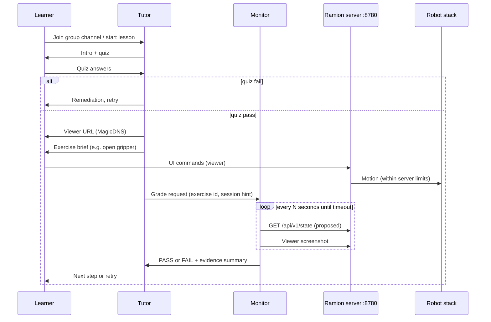

# Ramion multi-agent architecture

This document defines **boundaries**, **data flow**, and **observability choices** for the Grok Bot hackathon submission (Tutor + Monitor). **Watcher** is described only as an external boundary.

## Agents and responsibilities

### Tutor bot

| Owns | Does not own |
|------|----------------|
| Curriculum delivery, tone, pacing | Physical e-stop or motor commands directly |
| Safety quiz gate before sharing viewer URL | Continuous 24/7 vision surveillance |
| Exercise assignment and learner encouragement | Final truth on pass/fail (delegates to Monitor) |
| Calling **soft-stop** API + Discord alert when learner reports trouble or Monitor flags danger | Abuse detection at scale (Watcher) |

**Approval boundaries:** Tutor shares the Tailscale viewer link only after quiz pass. Tutor must not skip Monitor grading for scored exercises.

### Monitor bot

| Owns | Does not own |
|------|----------------|
| Opening the viewer URL (MagicDNS) on a schedule | Teaching narrative or quiz content |
| Screenshot cadence and/or polling proposed status API | Issuing new exercises to the learner |
| Applying rubrics → structured **PASS** / **FAIL** + reason | Hard e-stop (may recommend Tutor call soft-stop) |

Monitor is **stateless between grading runs** except for optional session notes in channel thread; source of truth for arm state is the server at `:8780`.

### Watcher bot (colleague-owned — not in this repo)

Documented boundary only:

- **Purpose:** Detect bad actors, reckless trajectories, or policy violations outside exercise scope.
- **Inputs:** Same viewer (higher cadence or dedicated stream processing), logs, optional joint telemetry.
- **Outputs:** Alerts to ops / Discord; may trigger soft-stop or session revoke on the server.
- **Not duplicated here** so hackathon judges can see a clean **Tutor ↔ Monitor** teaching loop without conflating safety monitoring with grading.

## End-to-end data flow

## Tailscale reachability

| Actor | Typical access |
|-------|----------------|
| Learner browser | Tailscale client on laptop; opens MagicDNS viewer URL |
| Grok Bot Monitor | Hosted agent with **Tailscale** egress to tailnet (see `SETUP.md`); base URL `http://ramion-server-01.tail0fbdb0.ts.net:8780` |
| Tutor | Usually no direct HTTP to arm; shares link and coordinates Monitor |

**Why MagicDNS for Monitor:** Cloud-hosted Grok Bot runners may not resolve short names like `ramion-server-01`. MagicDNS FQDN is stable for skills and env vars.

**Secrets:** No tailnet keys in this repo. Operators configure Tailscale on the agent environment or use team-approved network path.

## Vision: screenshot cadence vs RTSP subscribe

Monitor could theoretically subscribe to an RTSP/WebRTC video stream. This design **intentionally uses sequential viewer screenshots (and API state)** because:

1. **Same surface as the learner** — grades what the human sees in the product UI, including overlays and disabled states.
2. **Agent-native** — Grok Bot browser/screenshot tools fit a cadence loop (`every 2–3s` for 30–60s) without maintaining a long-lived media decoder in the agent runtime.
3. **Deterministic rubrics** — gripper open/close maps cleanly to UI labels or `gripper_open: true` in proposed JSON (see `api/contract.md`).
4. **Cost and complexity** — RTSP adds firewall rules, auth, and frame sync; screenshot + API is enough for hackathon exercises (open gripper, close gripper, move to preset).
5. **Watcher separation** — higher-rate or model-based anomaly detection can attach to RTSP on the Watcher side without changing Tutor/Monitor.

When API state is available, Monitor should **prefer API for pass/fail** and use screenshots for **dispute resolution** or when API fields are TODO on the server.

## Soft stop vs hard e-stop

| Layer | Mechanism | Owner |
|-------|-----------|--------|
| Hard e-stop | Hardware / robot controller | Robot stack |
| Soft stop | HTTP `POST /api/v1/control/soft-stop` (proposed) | Ramion server |
| Chat alert | Discord webhook (optional env) | Ops |

Tutor instructions: on learner panic or Monitor `FAIL` with safety keyword, call soft-stop once and tell learner the session is frozen until ops reset.

## Failure modes

| Symptom | Tutor behavior | Monitor behavior |
|---------|----------------|------------------|
| Tailscale down | Do not share URL; link SETUP | Abort grade with `INCONCLUSIVE` |
| API 404 (not implemented yet) | Still run exercises | Grade from screenshots only; note in result |
| Ambiguous screenshot | Allow one retry | `FAIL` with “state unclear” |
| Dangerous motion (Watcher) | Relay Watcher alert if wired | Out of scope; Watcher handles |

## Related files

- [`../api/contract.md`](../api/contract.md) — proposed HTTP surface
- [`../bots/tutor/PERSONA.md`](../bots/tutor/PERSONA.md) — Tutor boundaries
- [`../bots/monitor/PERSONA.md`](../bots/monitor/PERSONA.md) — Monitor boundaries
- [`../SETUP.md`](../SETUP.md) — Tailscale + bot wiring
