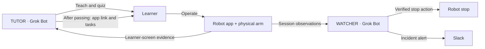
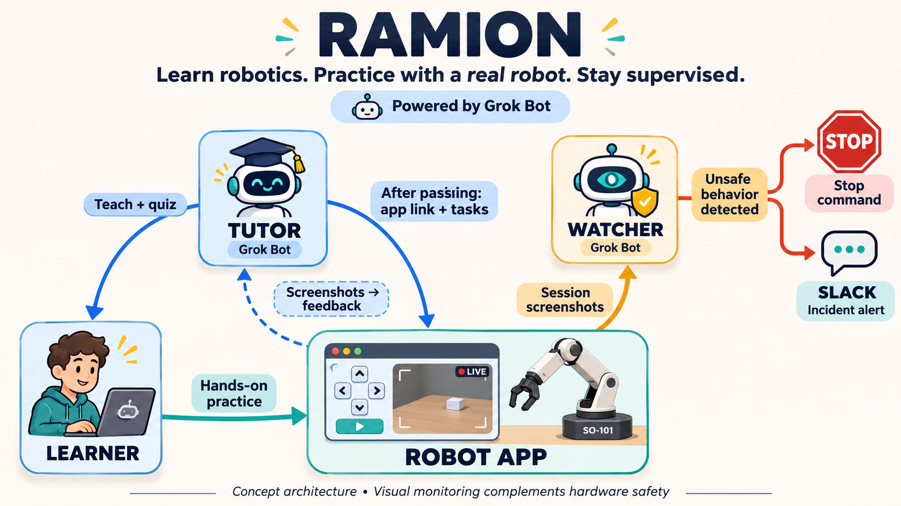

# RAMION TUTOR

A Grok Bot onboarding coach for a robot-control app: teach, quiz, share the app link, guide practice, and evaluate visible evidence.

## Start in five minutes

1. In Grok Bot, select **New Bot (+)** and name it **TUTOR**.
2. Paste [TUTOR_PROMPT.md](TUTOR_PROMPT.md) into the new chat. These are the bot's source instructions, not an executable configuration format.
3. Privately supply your app URL and evidence mode:
   - `shared_screen`: learner uses the same browser in the bot's computer preview, if handoff is available.
   - `uploaded_screenshots`: learner operates in their browser and provides before/after screenshots.
4. Ask the bot to open the app read-only and confirm it can see a current camera view. If private-network access fails, use screenshot mode for the first demo.
5. Send **Start onboarding**.

The app URL is deployment-specific and intentionally absent from this public repository. No API key is required by these instructions beyond the user's Grok Bot account and its available capabilities.

## One-hour scope

| Time | Outcome |
| --- | --- |
| 0–10 min | Create TUTOR; confirm screen access or use screenshot mode |
| 10–25 min | Run the intro and quiz; deliberately answer one question incorrectly |
| 25–40 min | Run two observation tasks with before/after evidence |
| 40–50 min | Try missing evidence and a request to skip the quiz |
| 50–60 min | Record the demo; link this folder in the submission |

Use one bot and check when the learner says **check**. Continuous polling and a dedicated monitoring bot are optional extensions. Enable physical practice only when the operator has specified and validated the exercise and stop procedure.

## What to demonstrate

A learner makes a mistake, gets a short explanation, passes the quiz, opens the app, completes a visible task, and receives evidence-based feedback. This demonstrates Grok Bot doing the work at runtime.

The quiz gates the lesson flow and app-link reveal. It is **not server-enforced access control**. Screenshots cannot prove an entire motion trajectory or malicious intent.

## How it fits with WATCHER

WATCHER is a separate team contribution. This folder implements its tutor-side concept and pause behavior, not WATCHER's monitor, stop adapter, or Slack integration. The full diagram describes the intended system.

A separate browser may observe the same physical robot but not the learner's browser-local camera layout. Check layout tasks from the learner's actual screen. Stop commands need a tested robot-side implementation; closing an app is not proof that motion stopped.

## Why this belongs on GitHub

The reproducible source is the bot's instructions, assessment rubric, setup procedure, and demo checks. A separate web app is unnecessary for this prototype. Reviewers can reproduce the bot by pasting the versioned instructions into Grok Bot.

Whether an instruction-based submission meets all judging requirements remains the organizer's decision; no unpublished hackathon rules have been verified.

## Validation status

Prepared instructions and demo checks only. No live Grok Bot onboarding, robot motion, monitoring loop, stop action, or Slack delivery was executed during preparation. Record actual results with [DEMO_CHECKS.md](DEMO_CHECKS.md); do not present unchecked items as passing.

## Product references

- [Create and manage Bots](https://docs.x.ai/grok-bot/bots): create a named bot and give its role through chat; optional template sharing.
- [Computer and apps](https://docs.x.ai/grok-bot/computer-and-apps): bot computer, screen handoff, and shared-account resources.
- [Private networks](https://docs.x.ai/grok-bot/private-networks): private addresses may require organization-approved networking.

Checked 2026-11-05. Available features depend on the installed version and account.

## Solution drawing

